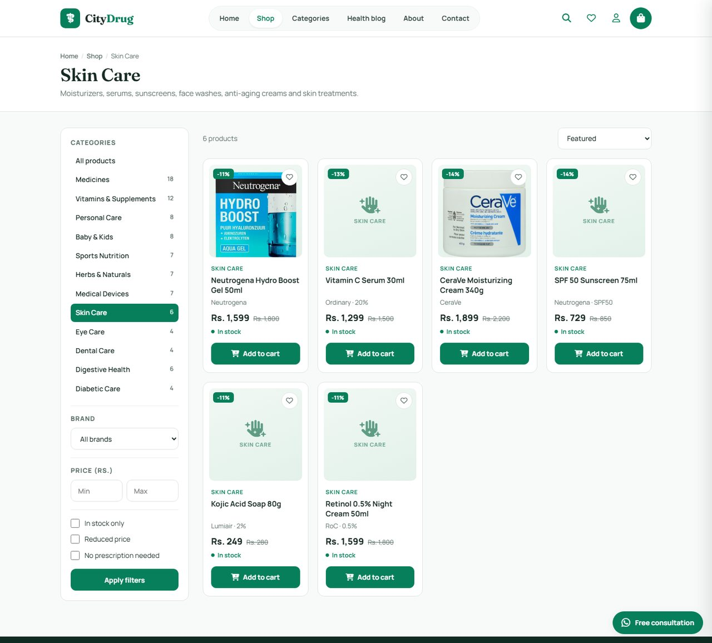
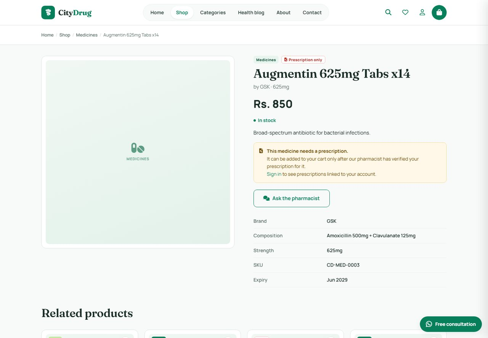
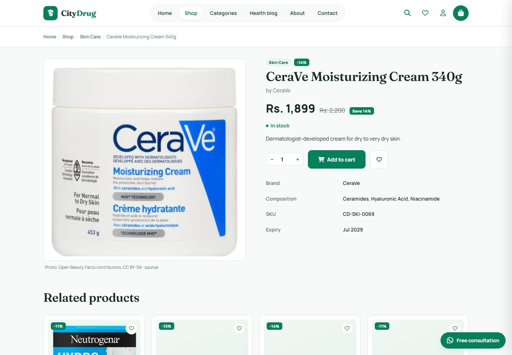
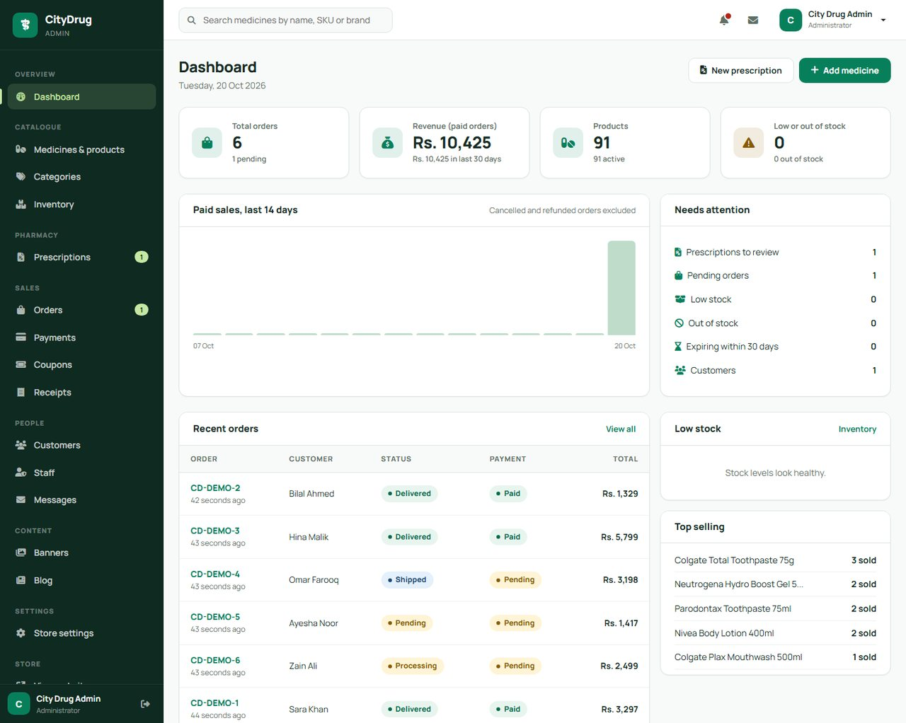
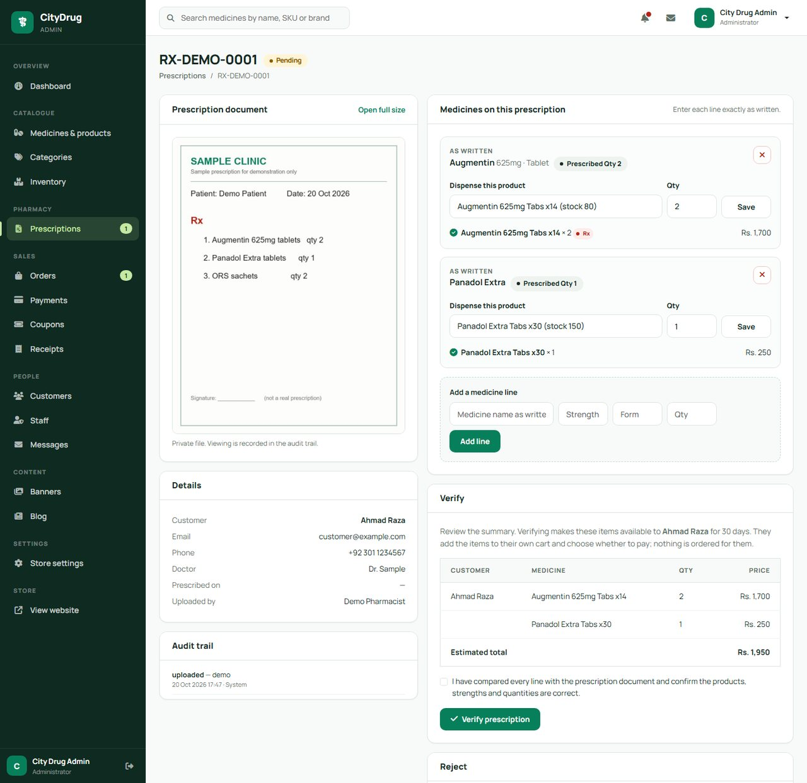
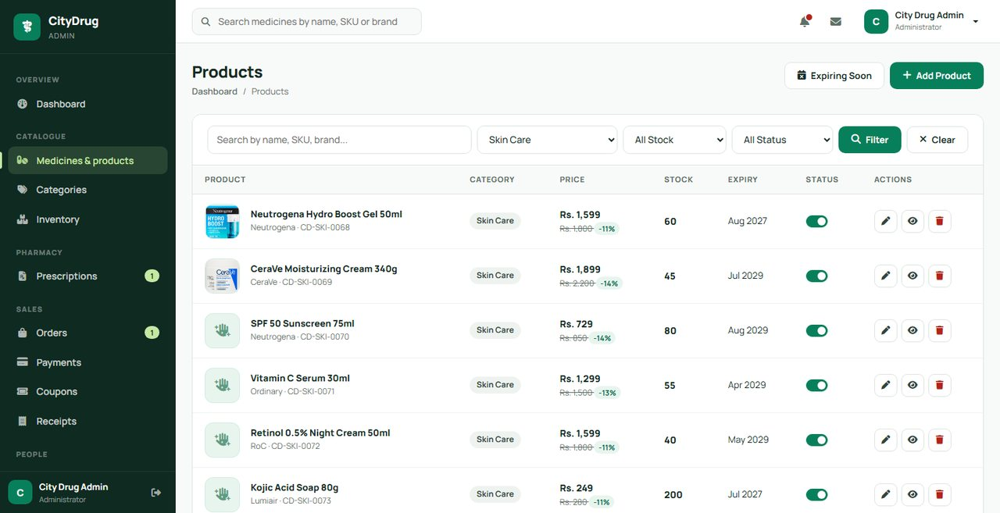
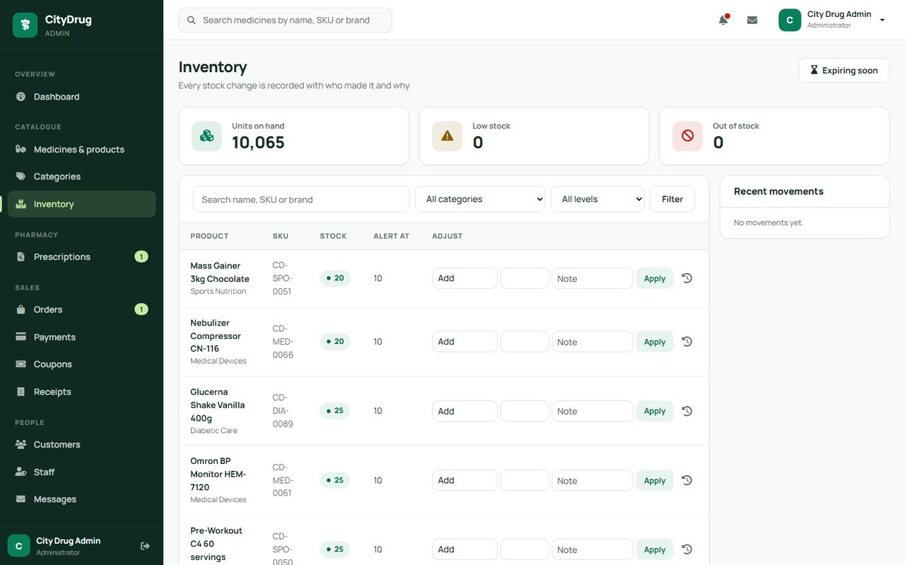
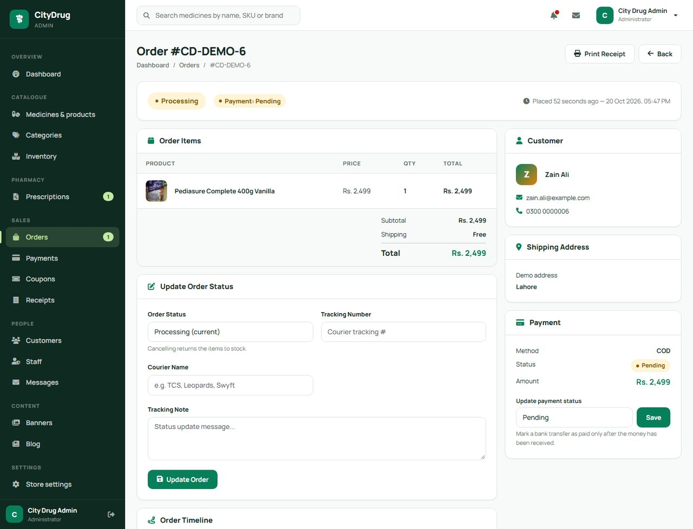
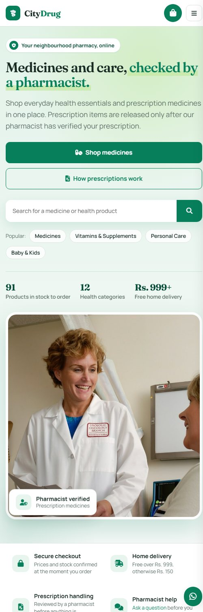

# CityDrug — Online Pharmacy Management System

An online pharmacy storefront and admin back office built with **Laravel 12** and **MySQL**. Customers browse and order medicines and health products; pharmacy staff manage the catalogue, stock, orders and — importantly — **verify prescriptions before any prescription-only medicine can be bought**.


## Highlights

- **Pharmacist-verified prescriptions.** Staff upload a prescription for a specific customer, match each line to a catalogue product, and a pharmacist verifies it. Only then can the customer add those medicines (up to the approved quantity) to their cart. Nothing is ordered or charged automatically.
- **Server-trusted checkout.** The browser never sets a price: the cart stores only product ids and quantities, and totals, stock, coupons and prescription limits are recalculated from the database inside a transaction.
- **Inventory you can audit.** Every stock change (sale, restock, cancellation, manual adjustment) is logged with who, why and the resulting balance; overselling is prevented with row locks.
- **Role-based staff access.** Customers, pharmacists (prescriptions only), administrators and super administrators.

## Screenshots

| Storefront | Shop & filters |
|---|---|
|  |  |
| **Prescription medicine page** | **Product page** |
|  |  |

| Admin dashboard | Prescription review |
|---|---|
|  |  |
| **Products** | **Inventory** |
|  |  |

| Order management | Mobile |
|---|---|
|  |  |

> Screenshots use fictional demo data. Product photos shown for a few items come from Open Beauty/Food Facts contributors (CC BY-SA); they are not part of this repository.

## Features

### Storefront (customers)
- Responsive home page with hero, trust strip, categories, featured / new / reduced products (all loaded from the database)
- Shop with search, category and brand filters, price range, in-stock / on-sale / no-prescription filters, sorting and pagination
- Product pages with gallery, specifications, stock status and clear prescription requirements
- Cart drawer and cart page with live quantity updates, coupon codes, free-delivery threshold and server-side validation
- Checkout for guests **or** accounts; optional "create an account" at checkout; cash on delivery and bank transfer (no fake online payments)
- Sign-in with email/password or **Google** (optional), password reset, profile, order history and order tracking timeline
- Wishlist, health blog, about and contact pages (contact messages are stored and shown in the admin panel)
- Fallback tiles for products without photos, accessible markup, keyboard focus styles, reduced-motion support

### Prescription workflow
1. Staff search for the **customer** first, then upload the prescription (JPG / PNG / PDF, max 5 MB) to a **private** disk.
2. Medicines are entered as written (optional OCR can pre-fill them as *unverified suggestions*).
3. Each line is matched to a product from ranked suggestions that show how confident the match is (name / strength) — nothing is auto-selected.
4. Approved quantities are checked against the prescribed quantity and available stock.
5. A staff member confirms and **verifies** (or rejects with a reason). Every step is written to an audit trail, including file views.
6. The customer reviews the verified items in their account, adds them to their cart and checks out. The allowance is consumed as they buy.

### Admin panel
- Dashboard with real figures: orders, revenue (paid, non-reversed orders only), 14-day sales, low stock, top sellers, items needing attention
- Medicines/products: create, edit, images and gallery, price / sale price, stock, expiry, Rx flag, active state (products that were ordered are deactivated, not deleted)
- Categories (safe delete with product reassignment), inventory with history, coupons, banners, blog, settings
- Orders with validated status transitions (cancelling returns stock), payment status, tracking, receipts
- Customers with order and prescription history; staff accounts (super admin only)
- Contact messages inbox

## Tech stack

| Layer | Technology |
|---|---|
| Backend | PHP 8.2+, Laravel 12 (Eloquent, policies, middleware, form validation, services) |
| Database | MySQL / MariaDB (SQLite is used for the automated tests) |
| Frontend | Blade templates, Bootstrap 5 grid, Font Awesome, vanilla JavaScript, a custom emerald design system |
| Auth | Laravel session auth, role middleware, optional Google OAuth 2.0 |
| Storage | Private `prescriptions` disk for medical documents, public folder for catalogue images |
| Testing | PHPUnit — 59 feature tests covering cart, checkout, authorization, inventory, prescriptions and sign-up |

## Getting started

### Requirements
- PHP 8.2 or newer with `pdo_mysql`, `mbstring`, `fileinfo`, `gd`
- Composer 2
- MySQL 8 or MariaDB 10.6+

### Installation

```bash
git clone https://github.com/Usman552/pharmacy-management-system.git
cd pharmacy-management-system

composer install
cp .env.example .env
php artisan key:generate
```

Create an empty database and put its details in `.env`:

```env
DB_DATABASE=city_drug
DB_USERNAME=root
DB_PASSWORD=
```

Then create the tables, load the demo catalogue and start the server:

```bash
php artisan migrate --seed
php artisan serve --port=8090
```

Open <http://127.0.0.1:8090>. The admin panel is at `/admin`.

### Demo accounts (created by the seeder)

| Role | Email | Password |
|---|---|---|
| Administrator | `admin@citydrug.pk` | `admin123` |
| Pharmacist (prescriptions only) | `pharmacist@citydrug.pk` | `pharmacist123` |
| Customer | `customer@example.com` | `password` |

> These are **demo credentials for local use only**. Change or delete them before any real deployment.

### Running the tests

```bash
php artisan test
```

### Optional configuration

| Feature | How |
|---|---|
| Store details | Admin → Store settings: phone, email, address, WhatsApp, free-delivery amount, delivery charge, prescription validity (days). Empty contact details are simply not shown. |
| Google sign-in | Create an OAuth client at the Google Cloud console, add `<your-site>/auth/google/callback` as a redirect URI, then set `GOOGLE_CLIENT_ID` and `GOOGLE_CLIENT_SECRET` in `.env`. The button appears automatically. |
| Prescription OCR | Implement `App\Services\Contracts\PrescriptionExtractor` and set `PRESCRIPTION_OCR_CLASS`. Without it, staff enter medicines by hand. OCR output is only ever a suggestion. |
| Product photos in bulk | `php artisan products:import-images "D:\photos" --dry-run` — files are matched by product name, slug, SKU or id. |
| Outgoing mail | Set the `MAIL_*` values in `.env` (needed for password-reset emails). |

## Project structure

```
app/
  Console/Commands/       bulk image importer
  Http/Controllers/       storefront, auth, account and Admin/* controllers
  Http/Middleware/        EnsureRole (role checks run before route binding)
  Models/                 Product, Order, Prescription, StockMovement, ...
  Policies/               PrescriptionPolicy
  Services/               CartService, StockService, PrescriptionService
database/                 migrations and seeders
resources/views/          Blade views (storefront, admin, auth, account)
public/                   css/citydrug.css (storefront), css/admin.css, js
tests/Feature/            cart, checkout, admin access, prescriptions, signup
```

## Security notes

- Prices, stock, coupons and prescription allowances are always recalculated on the server; request values are ignored.
- Stock changes use row locks and run inside database transactions.
- Prescription files live on a private disk and are streamed only to the owner or authorised staff (`X-Content-Type-Options: nosniff`, no caching); uploads are validated by type and size.
- Staff accounts cannot sign in through Google; roles are enforced on the server for every admin route.
- Orders are only visible to their owner; order confirmations are tied to the buyer's session.

## Not included yet

- Online card payments (checkout offers cash on delivery and bank transfer)
- Customer self-service prescription upload (currently staff upload on the customer's behalf)
- Email notifications for order status changes

## Credits

- Hero and pharmacy photography: [Unsplash](https://unsplash.com) (Unsplash License).
- Icons: [Font Awesome](https://fontawesome.com) free. Fonts: Fraunces and Manrope (Google Fonts, OFL).
- Demo product photos in the screenshots: Open Beauty Facts / Open Food Facts contributors, CC BY-SA.

## License

No license has been chosen yet; all rights reserved by the repository owner until one is added.
